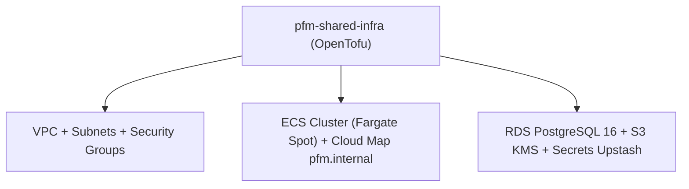

# PFM Shared Infra — Landing Zone Multicloud & Local Cloud

[](CONTRIBUTING.md)
[](CHANGELOG.md)
[](https://sorobanerp.github.io/pfm-docs/)

---

## 1. Visão Geral & Papel na Arquitetura

Provisiona a infraestrutura compartilhada base em AWS `us-east-2`: **VPC**, Cluster **ECS Fargate Spot (`pfm-pilot-prod`)**, **Service Connect (`pfm.internal`)**, **RDS PostgreSQL 16**, **S3 Criptografado KMS**, **Secrets Manager Upstash Kafka/Redis**, **AWS KMS** e **EKS condicional (`compute_engine`)** + ambiente `local-cloud/`.

- **Repositório:** `Sorobanerp/pfm-shared-infra`
- **Vínculo com `pfm-docs`:** `ADR-006, ADR-007, ADR-008, ADR-010 | US-01, US-15`



---

## 2. Pré-requisitos & Variáveis de Ambiente

### Pré-requisitos
- OpenTofu `>= 1.8.0`
- Trivy `>= 0.50`
- Docker & Docker Compose (para `local-cloud/`)
- AWS CLI v2 (autenticado via OIDC no CI)

### Variáveis de Ambiente (Sem Segredos Hardcoded)
| Variável | Padrão | Descrição |
| :--- | :---: | :--- |
| `AWS_REGION` | `us-east-2` | Região primária AWS |
| `TF_VAR_compute_engine` | `ecs_fargate_spot` | Motor de compute (`ecs_fargate_spot` ou `eks`) |
| `TF_VAR_environment` | `prod` | Ambiente alvo (`pilot` / `prod`) |
| `TF_STATE_BUCKET_AWS` | *(CI Secret/Var)* | Bucket S3 de state remoto OpenTofu |

> **Segurança (Zero-Trust):** Nunca commite tokens, senhas, chaves AWS ou strings de conexão com credenciais reais. Utilize `.env` local (ignorado no `.gitignore`) ou AWS Secrets Manager / GitHub OIDC.

---

## 3. Como Executar Localmente

```bash
# Subir infraestrutura local (PostgreSQL 15432, Redis 16379, Kafka 19092, Envoy 18080, LocalStack 14566)
docker compose -f local-cloud/docker-compose.yml up -d
docker compose -f local-cloud/docker-compose.yml ps
```

---

## 4. Como Testar e Validar

```bash
tofu fmt -check -recursive terraform/
tofu -chdir=terraform/aws init -backend=false && tofu -chdir=terraform/aws validate
trivy config --severity CRITICAL,HIGH --exit-code 1 terraform/
```

---

## 5. Como Provisionar / Validar na Nuvem

1. Fluxo Gitflow: `feat/*` $\rightarrow$ `develop` $\rightarrow$ `release/vX.Y.Z` $\rightarrow$ `main` (com GMUD).
2. O pipeline `infra-opentofu-ci-cd.yml` realiza backup `last-good` no S3, executa `tofu apply` via OIDC e possui rollback automático em caso de falha.
3. Validação pós-deploy: `aws ecs describe-clusters --clusters pfm-pilot-prod --region us-east-2`.

Consulte [CONTRIBUTING.md](CONTRIBUTING.md) para regras de Conventional Commits e [CHANGELOG.md](CHANGELOG.md) para histórico de versões.
